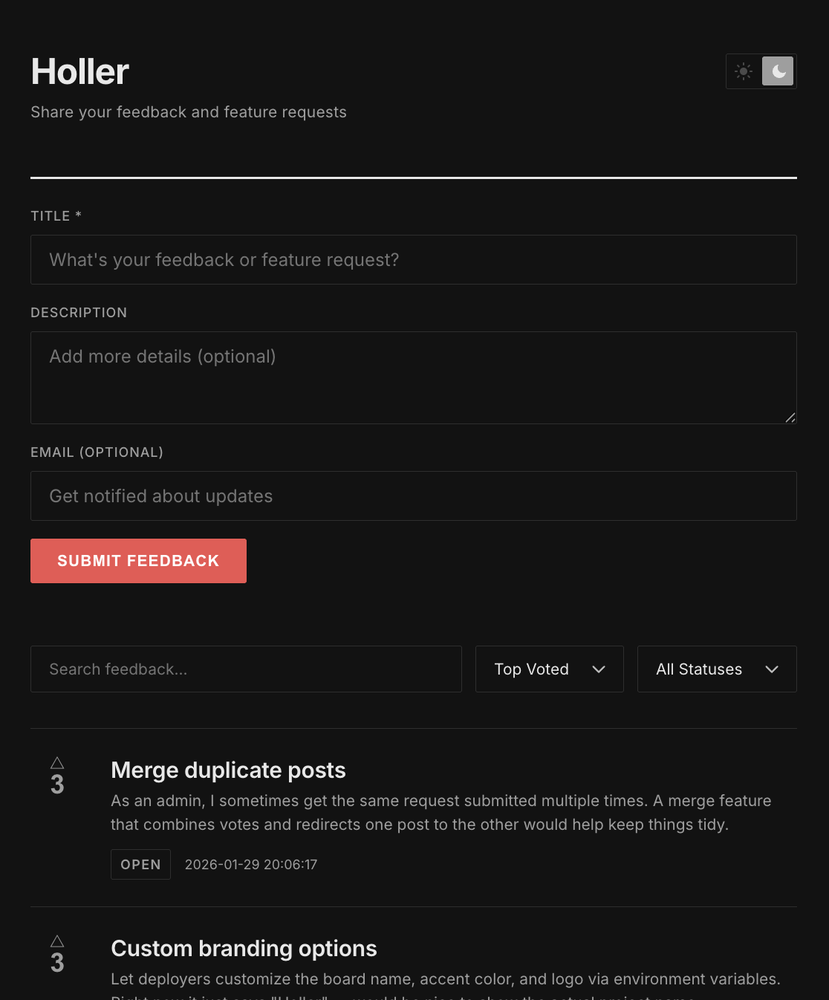

# Holler

为你的产品收集功能请求和反馈。开源、易于品牌化、一键部署。

无需服务器。无需容器。无需管理数据库。完全运行在 Cloudflare 免费层上，永久免费运行。

[](https://holler-demo.holler-25b.workers.dev) [](https://deploy.workers.cloudflare.com/?url=https://github.com/wassertim/holler)



## 功能

- **投票**——每位访客一票
- **全文搜索**——由 SQLite FTS5 提供支持
- **状态跟踪**——开放中、已计划、进行中、已完成、已关闭
- **管理员控制**——更新状态和删除帖子
- **防垃圾**——Cloudflare Turnstile（免费）
- **无需 JavaScript 也能工作**——渐进增强

## 工作原理

Holler 运行在 [Cloudflare Workers](https://workers.cloudflare.com/) 上，使用 [D1](https://developers.cloudflare.com/d1/) SQLite 数据库。UI 是服务端渲染的 HTML，并通过 [HTMX](https://htmx.org/) 增强——无需前端构建步骤，无需客户端框架。

## 部署

点击部署按钮。Cloudflare 会自动配置一切——Worker、数据库和迁移。

部署后，可选配置 [Turnstile](https://developers.cloudflare.com/turnstile/) 用于防垃圾，以及管理员 token 用于审核。详情请参阅[设置指南](docs/setup.md)。

## 本地开发

```bash
git clone https://github.com/wassertim/holler.git
cd holler
npm install
npx wrangler d1 migrations apply holler-db --local
npm run dev
```

在 `http://localhost:8787` 打开。本地会跳过 Turnstile。管理员访问和配置请参阅[设置指南](docs/setup.md)。

## 许可证

MIT
